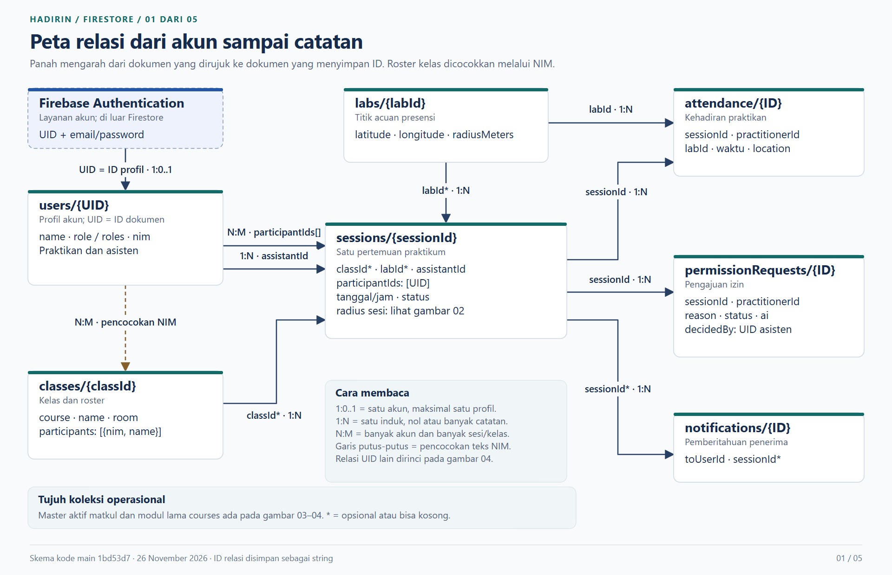
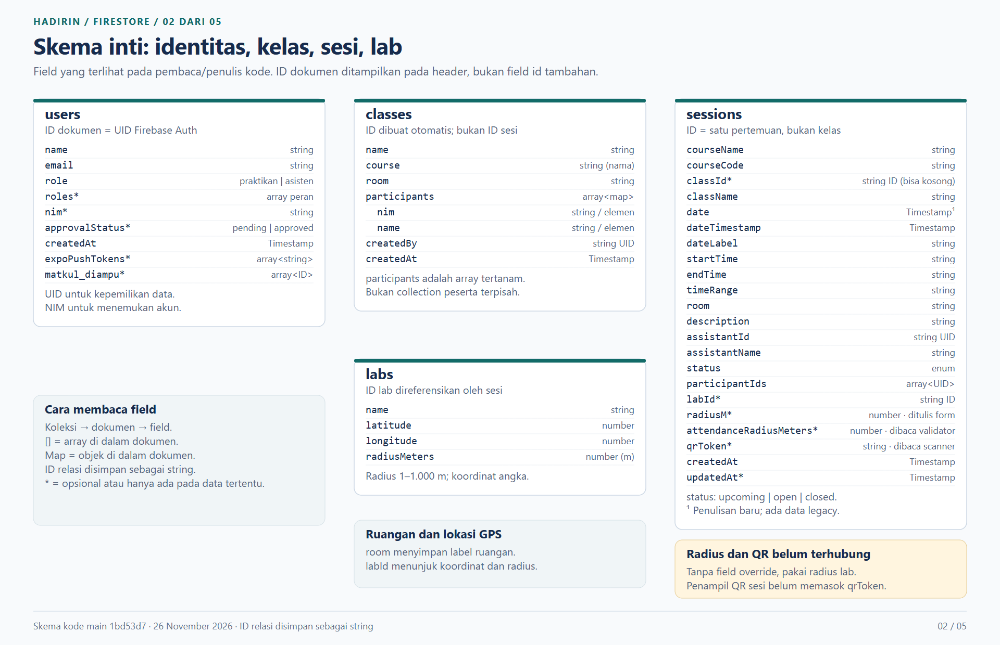
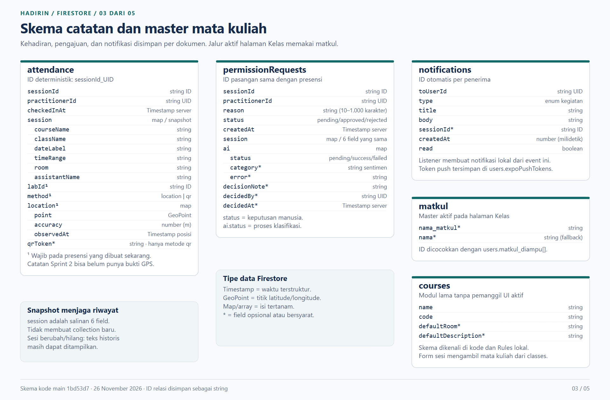
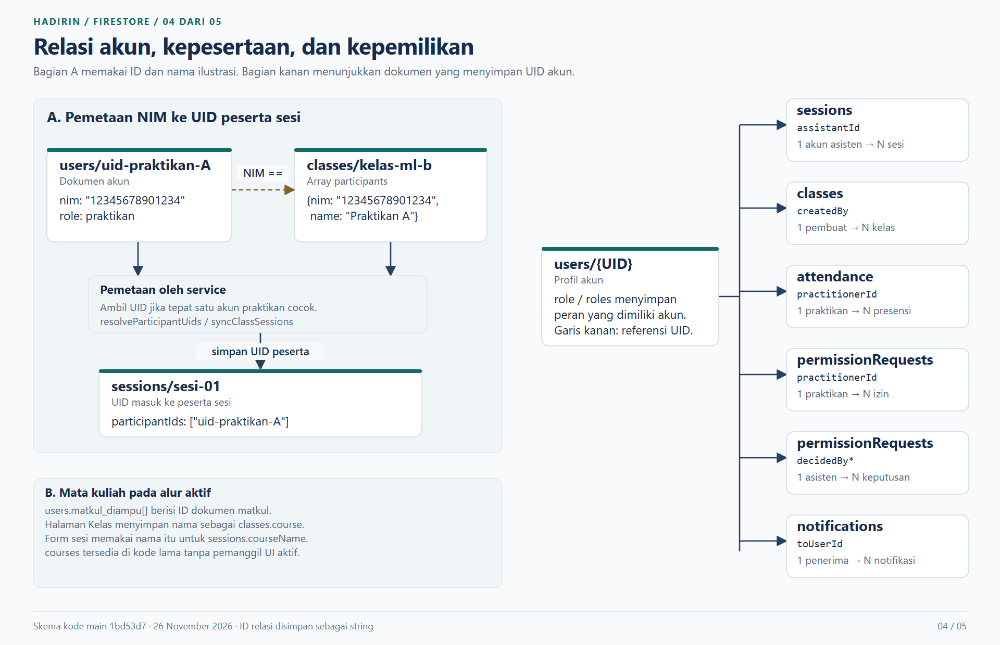
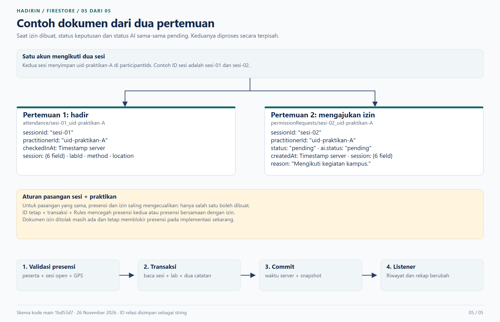

# Visualisasi Database Firestore — Bahan Presentasi Hadirin

**Mulai presentasi:** buka [visualisasi-database.html](visualisasi-database.html) langsung di Chrome/Edge. Tidak perlu Metro, login, atau internet. Pilih gambar 01–05, gunakan tombol panah kiri/kanan, dan tekan **Layar penuh** atau F11. Untuk PowerPoint/Canva, gunakan PNG pada `docs/gambar/database`; SVG tetap tajam ketika diperbesar.

Acuan visual adalah kode `main` **`1bd53d7`** yang diperiksa pada 26 November 2026. Delapan koleksi terhubung ke alur aplikasi. Satu nama tambahan, `courses`, masih tercantum pada modul lama dan Rules lokal. Semua contoh ID, NIM, nama, dan koordinat adalah ilustrasi. Isi Firebase Console belum diperiksa.

## Daftar isi

1. [Cara membaca diagram](#1-cara-membaca-diagram)
2. [Peta hubungan utama](#2-peta-hubungan-utama)
3. [Skema collection inti](#3-skema-collection-inti)
4. [Skema catatan dan master](#4-skema-catatan-dan-master)
5. [Relasi akun dan pemetaan NIM](#5-relasi-akun-dan-pemetaan-nim)
6. [Contoh dokumen dan anti-duplikasi](#6-contoh-dokumen-dan-anti-duplikasi)
7. [Tabel seluruh relasi](#7-tabel-seluruh-relasi)
8. [Mengapa data disimpan seperti ini](#8-mengapa-data-disimpan-seperti-ini)
9. [Urutan penjelasan saat presentasi](#9-urutan-penjelasan-saat-presentasi)
10. [Pertanyaan dosen dan jawaban](#10-pertanyaan-dosen-dan-jawaban)
11. [Batas implementasi yang perlu dijelaskan jujur](#11-batas-implementasi-yang-perlu-dijelaskan-jujur)
12. [Berkas dan sumber](#12-berkas-dan-sumber)

## 1. Cara membaca diagram

Firestore adalah database dokumen NoSQL. Proyek ini menyimpan **collection → document → field**. Kotak pada diagram mewakili kumpulan dokumen, bukan tabel SQL yang mempunyai foreign key otomatis. Konsep ini mengacu pada [model data Cloud Firestore](https://firebase.google.com/docs/firestore/data-model); relasi spesifiknya dicocokkan dengan source Hadirin.

| Tanda/istilah | Cara membacanya |
| --- | --- |
| `users/{UID}` | Collection `users`, dengan ID dokumen sama dengan UID pengguna. Tanda kurung kurawal menunjukkan ID yang bervariasi. |
| `1:N` atau satu-ke-banyak | Satu induk dapat diacu banyak dokumen anak; misalnya satu kelas mempunyai banyak sesi. N bisa nol, satu, atau lebih. |
| `N:M` atau banyak-ke-banyak | Satu praktikan mengikuti banyak sesi dan satu sesi berisi banyak praktikan. Di proyek ini sebagian direpresentasikan array, bukan tabel penghubung baru. |
| Garis berpanah + nama field | Panah mengarah dari dokumen yang dirujuk ke dokumen yang menyimpan field ID. Contoh `labs → sessions` dibaca sebagai `sessions.labId` menyimpan ID lab. |
| Garis putus-putus NIM | Pencocokan nilai teks NIM oleh service, bukan `DocumentReference` atau foreign key UID. |
| Kotak Auth biru putus-putus | Firebase Authentication adalah layanan akun di luar collection Firestore. |
| Field dengan `*` | Opsional, bersyarat, atau hanya tersedia pada sebagian versi data. |
| `array<...>` / `[]` | Daftar di dalam satu dokumen. Tidak otomatis menjadi subcollection. |
| `map` | Objek tertanam di dokumen, seperti `ai`, `session`, dan `location`. |
| Timestamp | Waktu terstruktur Firestore. Berbeda dari label tanggal string dan number milidetik. |
| GeoPoint | Tipe titik latitude/longitude untuk bukti posisi. |

Kardinalitas menunjukkan **hubungan logis yang dibentuk aplikasi**. Setiap UID Auth memiliki nol atau satu profil dengan ID yang sama. Sebagian sesi bisa belum mempunyai referensi kelas atau lab. Untuk detail tiap field gunakan [kamus Database Firestore](../../database-firestore.md).

## 2. Peta hubungan utama

**Cara menjelaskan gambar:**

1. Pengguna login melalui **Firebase Authentication**. UID hasil login dipakai sebagai ID profil pada `users`.
2. **Kelas** menyimpan identitas kelompok dan daftar peserta. Satu kelas dapat mempunyai beberapa pertemuan pada `sessions`.
3. **Sesi** menjadi pusat kegiatan: siapa pesertanya, siapa asistennya, kapan berlangsung, status, dan lab yang dipakai.
4. **Lab** menyimpan koordinat dan radius. Nama ruangan saja tidak cukup untuk validasi GPS.
5. Ketika praktikan hadir, dibuat dokumen **attendance** yang mengacu sesi, UID praktikan, serta lab.
6. Jika berhalangan, dibuat **permissionRequests** yang mengacu sesi dan UID praktikan, ditambah alasan, status, dan hasil AI.
7. **Notifications** mencatat pemberitahuan kepada UID tertentu, dengan konteks sesi jika tersedia.

Gambar pertama menampilkan tujuh koleksi operasional. Gambar 03–04 menambahkan `matkul` sebagai master aktif dan mendokumentasikan `courses` sebagai skema yang masih dikenali kode. Firebase Authentication berada di luar Firestore.

## 3. Skema collection inti

| Collection | Satu dokumen mewakili | Penanda yang dipakai |
| --- | --- | --- |
| `users` | Satu profil akun. | ID dokumen = UID Auth; NIM tetap field string. |
| `classes` | Satu kelompok kelas suatu mata kuliah. | `classId` otomatis; roster berada dalam `participants`. |
| `sessions` | Satu pertemuan praktikum pada tanggal/jam tertentu. | `sessionId` otomatis; mengacu kelas, asisten, lab, serta array UID peserta. |
| `labs` | Satu laboratorium dengan titik/radius acuan. | `labId` otomatis; dipakai sesi dan catatan presensi. |

### Mengapa kelas dan sesi dipisah?

Kelas adalah kelompok peserta yang relatif tetap. Sesi adalah satu kejadian/pertemuan, sehingga kelas Pembelajaran Mesin B dapat mempunyai sesi minggu pertama, kedua, dan ketiga. Status buka/tutup dan presensi melekat pada pertemuan, bukan pada seluruh kelas.

### Mengapa ada data peserta pada kelas dan sesi?

`classes.participants` menyimpan roster berupa pasangan NIM/nama untuk pengelolaan. `sessions.participantIds` menyimpan **UID** agar aplikasi dan Rules dapat menentukan sesi yang boleh diakses akun login. Service melakukan pemetaan antara keduanya; bukan salinan dua array yang selalu otomatis sama.

### Apa arti `role` dan `roles`?

`role` adalah field dasar/legacy. `roles` mendukung akun yang mempunyai lebih dari satu peran. UI menggunakan peran aktif yang dipilih ketika login. Peran asisten/praktikan bukan dua collection pengguna terpisah pada implementasi ini.

## 4. Skema catatan dan master

| Collection | Mengapa dipisah dari sesi? |
| --- | --- |
| `attendance` | Banyak akun membuat catatan sendiri untuk banyak pertemuan; rekap dapat di-query per sesi dan Riwayat per UID. |
| `permissionRequests` | Mempunyai lifecycle pengajuan, AI, dan keputusan manusia yang berbeda dari catatan hadir. |
| `notifications` | Satu event dapat menghasilkan beberapa pemberitahuan penerima, masing-masing mempunyai status baca. |
| `matkul` | Menyediakan pilihan pada halaman Kelas dan pencocokan penugasan `matkul_diampu`. |
| `courses` | Skema master lama berisi nama, kode, dan nilai default. Modul dan Rules masih menyebutnya. Tidak ditemukan pemanggil aktif untuk `subscribeCourses` atau `seedCoursesIfEmpty`. |

Indentasi pada gambar menunjukkan field di dalam array/map. Misalnya `attendance.location.point` adalah GeoPoint dalam map `location`; bukan collection bernama `point`.

**`session`, `location`, dan `ai` bukan collection baru:**

- `session` adalah salinan ringkas enam field informasi sesi pada dokumen presensi/izin.
- `location` menyimpan titik, akurasi, dan waktu pembacaan posisi pada presensi.
- `ai` menyimpan status/hasil/kegagalan klasifikasi pada pengajuan izin.

Pada izin, `status` berisi `pending/approved/rejected`, sedangkan `ai.status` berisi `pending/success/failed`. AI berhasil berarti prediksi tersedia, **bukan izin otomatis diterima**.

## 5. Relasi akun dan pemetaan NIM

**Sisi kiri:**

1. Akun praktikan mempunyai NIM, misalnya string ilustrasi `12345678901234`.
2. Asisten menambahkan NIM yang sama ke roster kelas.
3. `resolveParticipantUids` mencari akun yang cocok secara unik. NIM ganda atau tidak ditemukan tidak dipilih secara sembarang.
4. `syncClassSessions`/pembuatan sesi memasukkan UID hasil pemetaan ke `participantIds`.
5. Listener praktikan menggunakan `array-contains UID`, sehingga sesi terdaftar dapat dibaca akun tersebut.

**Sisi kanan:** akun juga direferensikan sebagai pembuat kelas (`createdBy`), asisten sesi (`assistantId`), pemilik presensi/izin (`practitionerId`), pemberi keputusan (`decidedBy`), dan penerima notifikasi (`toUserId`).

Satu collection `users` dapat mempunyai beberapa **peran relasi**, bukan berarti ada beberapa pengguna berbeda untuk ID yang sama.

**Mata kuliah.** Halaman Kelas mencocokkan `users.matkul_diampu[]` dengan ID dokumen `matkul`, lalu memakai `nama_matkul`, `nama`, atau ID sebagai label pilihan. Pilihan disimpan sebagai `classes.course`. Form sesi membaca daftar kelas tersebut dan menyimpan nama mata kuliah ke `sessions.courseName`. `sessions.courseCode` disimpan sebagai teks dari form. [Halaman Kelas](../../../src/app/%28tabs%29/kelas.tsx) · [Form sesi](../../../features/asisten/components/SessionFormModal.tsx)

## 6. Contoh dokumen dan anti-duplikasi

Semua nilai berikut adalah ilustrasi, bukan data akun asli dan bukan payload untuk diunggah:

| Konsep | Contoh ID/path | Penjelasan |
| --- | --- | --- |
| Akun | `users/uid-praktikan-A` | ID sama dengan UID Auth ilustrasi. |
| Kelas | `classes/kelas-ml-b` | Kelompok peserta. |
| Sesi 1 | `sessions/sesi-01` | Pertemuan pertama; pengguna hadir. |
| Sesi 2 | `sessions/sesi-02` | Pertemuan lain; pengguna mengajukan izin. |
| Presensi | `attendance/sesi-01_uid-praktikan-A` | ID dibentuk dari sesi 1 dan akun A. |
| Izin | `permissionRequests/sesi-02_uid-praktikan-A` | ID dibentuk dari sesi 2 dan akun A. |

Kedua dokumen sesi di contoh memakai `classId: "kelas-ml-b"`, `labId: "lab-contoh"`, dan `participantIds: ["uid-praktikan-A"]`. Berikut perbandingan isi catatannya.

| Field | Presensi pada `sesi-01` | Izin pada `sesi-02` |
| --- | --- | --- |
| `sessionId` | `"sesi-01"` | `"sesi-02"` |
| `practitionerId` | `"uid-praktikan-A"` | `"uid-praktikan-A"` |
| Waktu server | `checkedInAt` | `createdAt` |
| `session` | Map berisi `courseName`, `className`, `dateLabel`, `timeRange`, `room`, `assistantName` pada sesi 01. | Enam field yang sama, diambil dari sesi 02. |
| Bukti atau alasan | `labId: "lab-contoh"`, `method: "location"`, `location: { point: GeoPoint(-7.05, 110.44), accuracy: 12, observedAt: Timestamp }` | `reason: "Mengikuti kegiatan kampus."` |
| Status | Kehadiran ditandai oleh keberadaan dokumen. | `status: "pending"` dan `ai: { status: "pending" }` ketika baru dibuat. |

### Mengapa ID tidak selalu dibuat acak?

Untuk presensi/izin, identitas unik yang dibutuhkan adalah **pasangan sesi–praktikan**. ID deterministik `${sessionId}_${uid}` membuat permintaan kedua menuju dokumen yang sama, bukan membuat ID acak lain.

Namun ID saja belum cukup. Transaksi membaca sesi, presensi pasangan, dan izin pasangan sebelum menulis; presensi lokasi juga membaca lab. Rules membatasi identitas, status, waktu server, data lokasi, dan larangan overwrite. Konsep transaksi mengacu pada [dokumentasi Firestore](https://firebase.google.com/docs/firestore/manage-data/transactions); penerapan spesifik ada pada `recordParticipation`.

| Pasangan sesi–praktikan | Boleh membuat presensi? | Boleh membuat izin? |
| --- | --- | --- |
| Belum mempunyai keduanya | Bisa, jika semua syarat presensi sah. | Bisa, jika syarat pengajuan sah. |
| Sudah mempunyai presensi | Tidak; duplikat. | Tidak; kehadiran sudah tercatat. |
| Sudah mempunyai izin pending | Tidak. | Tidak; pengajuan sudah ada. |
| Sudah mempunyai izin approved/rejected | Tidak menurut alur sekarang. | Tidak ada pengajuan ulang otomatis. |

Pengecualian berlaku per pasangan. Pengguna yang hadir pada sesi 1 tetap dapat mengajukan izin pada sesi 2, karena `sessionId` berbeda.

## 7. Tabel seluruh relasi

Tabel ini melengkapi gambar agar semua referensi tersimpan dapat dijelaskan tanpa menumpuk garis pada satu gambar. `N` berarti nol atau banyak. Relasi yang bergantung field opsional berlaku ketika field tersebut tersedia dan referensinya valid.

| No. | Induk → data terkait | Kardinalitas logis | Penghubung aktual | Makna |
| --- | --- | --- | --- | --- |
| 1 | Auth → users | 1:0..1 | Auth UID = ID dokumen users. | Satu akun memiliki maksimal satu profil. |
| 2 | users asisten → classes | 1:N | `classes.createdBy`. | Satu akun membuat beberapa kelas. |
| 3 | users asisten → sessions | 1:N | `sessions.assistantId`. | Satu asisten terkait beberapa pertemuan. |
| 4 | classes → sessions | 1:N; link sesi lama opsional. | `sessions.classId`. | Satu kelas mempunyai banyak pertemuan. |
| 5 | users praktikan ↔ classes | N:M secara roster. | `classes.participants[].nim == users.nim`, lalu dipetakan service. | Banyak praktikan terdaftar pada beberapa kelas; ini pencocokan NIM, bukan UID langsung. |
| 6 | users praktikan ↔ sessions | N:M | `sessions.participantIds[]` memuat UID. | Banyak peserta mengikuti beberapa sesi. |
| 7 | labs → sessions | 1:N; lab sesi bisa belum diatur. | `sessions.labId`. | Beberapa pertemuan menggunakan lab yang sama. |
| 8 | sessions → attendance | 1:N | `attendance.sessionId`. | Satu sesi memiliki catatan hadir banyak praktikan. |
| 9 | users praktikan → attendance | 1:N | `attendance.practitionerId`. | Satu akun mempunyai riwayat di beberapa sesi. |
| 10 | labs → attendance | 1:N | `attendance.labId`. | Catatan menyimpan lab yang dipakai ketika presensi. |
| 11 | sessions → permissionRequests | 1:N | `permissionRequests.sessionId`. | Satu sesi dapat mempunyai pengajuan beberapa praktikan. |
| 12 | users praktikan → permissionRequests | 1:N | `permissionRequests.practitionerId`. | Satu akun mengajukan izin untuk beberapa pertemuan. |
| 13 | users asisten → permissionRequests | 1:N; keputusan belum tentu ada. | `permissionRequests.decidedBy`. | Asisten menjadi pemberi keputusan, berbeda dari pemilik pengajuan. |
| 14 | users → notifications | 1:N | `notifications.toUserId`. | Satu penerima memperoleh beberapa pemberitahuan. |
| 15 | sessions → notifications | 1:N, konteks opsional. | `notifications.sessionId`. | Satu pertemuan terkait beberapa pemberitahuan/penerima. |
| 16 | users asisten ↔ matkul | N:M jika penugasan terisi. | `users.matkul_diampu[]` memuat ID dokumen matkul. | Memfilter pilihan mata kuliah asisten pada UI Kelas. |

Alur pilihan mata kuliah menyalin nama dari `matkul` ke `classes.course`, kemudian ke `sessions.courseName`. Hubungan berdasarkan ID pada bagian ini adalah `users.matkul_diampu[]` ke dokumen `matkul`.

`assistantName`, `className`, dan `courseName` yang disalin bukan hubungan tambahan hanya karena namanya mirip. Untuk mencari dokumen, identitas utama adalah ID. Kode masih mempunyai beberapa fallback pencocokan nama pada data legacy; itu logika service, bukan aturan database bawaan.

## 8. Mengapa data disimpan seperti ini?

### Referensi string

`sessionId`, `classId`, `labId`, dan UID adalah string yang dibaca service/Rules. Firestore tidak otomatis menjalankan SQL JOIN, mewajibkan foreign key, atau menghapus semua anak ketika induk dihapus. Relasi ini dikelola aplikasi.

### Data tertanam

Roster kelas dan UID peserta sesi dimasukkan sebagai array agar dapat dibaca bersama dokumen konteksnya. Objek AI dan lokasi dimasukkan sebagai map karena merupakan bagian dari satu pengajuan atau satu bukti kehadiran. Itu keputusan implementasi tugas; untuk skala besar ukuran array, pertumbuhan dokumen, dan konkurensi perlu ditinjau lagi.

### Denormalisasi/snapshot

Presensi/izin menyalin enam field sesi. Dengan begitu Riwayat masih punya nama praktikum, kelas, tanggal, jam, ruangan, dan asisten ketika dokumen sesi berubah/hilang. Konsekuensinya salinan historis tidak otomatis ikut berubah mengikuti jadwal baru.

### Akun dan hak akses

Auth membuktikan akun. Profil menyimpan identitas/peran, sedangkan Rules membatasi request client. UID praktikan dari Auth digunakan sebagai pemilik presensi/izin; aplikasi tidak mempercayai nama/NIM yang diketik untuk menentukan pemilik.

Penugasan mata kuliah pada UI belum otomatis menjadi jaminan otorisasi server. Halaman pending juga belum cukup karena fungsi Rules asisten perlu peninjauan. Jangan menyatakan database sudah aman sempurna hanya karena tombol disembunyikan.

## 9. Urutan penjelasan saat presentasi

| Waktu perkiraan | Tampilkan | Kalimat inti |
| --- | --- | --- |
| 0:00–0:45 | Gambar 01. | “Sesi adalah pusat pertemuan. Ia menghubungkan kelas, lab, asisten, dan peserta. Presensi serta izin mengacu sesi dan pengguna.” |
| 0:45–1:45 | Gambar 02. | “Kelas bukan sesi. Peserta kelas berupa NIM/nama, tetapi akses sesi memakai UID. Lab menyimpan koordinat dan radius.” |
| 1:45–2:45 | Gambar 03. | “Kehadiran menyimpan waktu server dan bukti lokasi. Izin memisahkan status keputusan dan status AI. Notifikasi disimpan per penerima.” |
| 2:45–3:30 | Gambar 04. | “NIM dipakai untuk mencari akun; setelah ditemukan, yang masuk participantIds adalah UID. Satu akun bisa berperan sebagai pembuat, peserta, pemilik record, atau pemberi keputusan.” |
| 3:30–4:30 | Gambar 05. | “Kombinasi sesi dan UID menjadi ID tetap. Transaksi dan Rules mencegah duplikasi serta presensi bersamaan dengan izin.” |
| 4:30–5:00 | Ringkasan/catatan batas. | “Ini model dokumen dengan referensi dan embedded data, bukan skema SQL. Beberapa integrasi masih perlu diseragamkan.” |

Gunakan satu gambar satu tahap, bukan mengecilkan lima gambar dalam satu slide. Jika menyalin ke slide, gunakan PNG; jika perlu memperbesar bagian field gunakan SVG. File HTML menampilkan satu gambar per pilihan dan menyediakan akses gambar langsung.

## 10. Pertanyaan dosen dan jawaban

| Pertanyaan | Jawaban yang sesuai implementasi |
| --- | --- |
| “Bukankah NoSQL tidak punya relasi?” | Hubungan data tetap ada. Yang berbeda adalah cara representasi dan penegakannya: string ID, array, map, service, transaksi, serta Rules, bukan foreign key SQL otomatis. |
| “Primary key kalian yang mana?” | Dalam istilah dokumen, ID dokumen adalah penanda unik. Profil memakai UID Auth; presensi/izin memakai pasangan sesi–UID; kelas/sesi/lab umumnya memakai ID otomatis. |
| “Mengapa bukan NIM sebagai ID semua dokumen?” | UID tersedia langsung dari Auth dan digunakan untuk otorisasi. NIM adalah atribut domain/pencarian, dapat belum diisi atau bermasalah/ganda pada data lama. |
| “Relasi many-to-many kalian di mana?” | Praktikan–sesi lewat `participantIds` array UID. Praktikan–kelas lewat roster NIM yang dipetakan ke akun. Presensi/izin sendiri adalah record hubungan per pasangan dan per kejadian. |
| “Di mana tabel peserta_sesi?” | Tidak ada collection dengan nama itu pada implementasi ini. Keanggotaan sesi ditanam pada array UID di dokumen sesi. |
| “Mengapa izin tidak dijadikan field pada presensi?” | Pengajuan, proses AI, keputusan, dan informasi alasan mempunyai lifecycle berbeda. Dalam alur saat ini satu pasangan tidak boleh punya keduanya. |
| “Bagaimana mencegah absen dua kali?” | ID pasangan tetap, transaksi membaca record terkini, serta Rules melarang overwrite. Menonaktifkan tombol hanya membantu UX. |
| “Kenapa data sesi disalin lagi?” | Snapshot/denormalisasi menjaga teks Riwayat tanpa harus selalu memperoleh dokumen sesi aktif. |
| “Apa beda Timestamp dan GeoPoint?” | Timestamp untuk waktu; GeoPoint untuk koordinat. Angka akurasi disimpan terpisah karena menjelaskan kualitas posisi. |
| “AI memutuskan izin?” | Tidak. `ai.status/category` hanya informasi klasifikasi; `status`, `decidedBy`, dan `decidedAt` adalah keputusan asisten. |
| “Bagaimana real-time antarpengguna?” | Client memasang `onSnapshot` pada query relevan. Setelah commit server, listener memperbarui state/UI pada perangkat yang berhak membaca. |
| “Jika kelas/sesi/lab dihapus, anaknya ikut hilang?” | Tidak otomatis. Tidak ada cascade hanya karena field referensi. Snapshot dan guard UI membantu sebagian kasus; konsistensi perlu ditangani aplikasi. |
| “Mana yang dipakai untuk mata kuliah?” | Halaman Kelas membaca `matkul`. Form sesi membaca nama dari `classes.course`. `courses` masih terdefinisi di kode dan Rules, dengan pemanggil UI aktif yang belum ditemukan. |
| “Apakah semua hubungan wajib?” | Desain mengharapkan hubungan lengkap, tetapi beberapa field masih opsional/data lama. ID string juga dapat menunjuk dokumen yang tidak ada; diagram bukan jaminan constraint server otomatis. |

## 11. Batas implementasi yang perlu dijelaskan jujur

Presentasi bisa menjelaskan desain dan kode tanpa mengklaim semua integrasi telah sempurna:

- Radius sesi memakai dua nama: form menulis `radiusM`, validator/Rules membaca `attendanceRadiusMeters` lalu fallback radius lab. Belum otomatis sama.
- Scanner membaca `sessions.qrToken`. Penampil QR asisten saat ini menghasilkan format yang tidak membawa token tersebut.
- Koleksi `notifications` pada jalur saat ini menghasilkan notifikasi lokal lewat listener; bukan bukti sender push remote sudah berjalan saat aplikasi ditutup.
- Aktivitas popup Maps masih dummy; itu terpisah dari data lab yang memang dibaca Firestore.
- AI pada aplikasi adalah classifier lokal + kata kunci, bukan pemanggilan API model pengajar.
- Rules aktif di Console dan isi data server belum diperiksa. Pembatasan yang terdefinisi pada checkout dapat dilihat di [Rules lokal](../../../firestore.rules).

Ini bukan anjuran mengganti skema malam sebelum presentasi. Visual menggambarkan struktur kode yang ada dan membantu menjelaskan hubungan secara benar; tidak menjalankan perbaikan aplikasi.

## 12. Berkas dan sumber

| Keperluan | Berkas |
| --- | --- |
| Buka langsung untuk presentasi offline | [visualisasi-database.html](visualisasi-database.html). |
| Gambar 01 | [PNG](01-peta-relasi.png) / [SVG](01-peta-relasi.svg). |
| Gambar 02 | [PNG](02-skema-inti.png) / [SVG](02-skema-inti.svg). |
| Gambar 03 | [PNG](03-skema-catatan-master.png) / [SVG](03-skema-catatan-master.svg). |
| Gambar 04 | [PNG](04-relasi-akun-nim.png) / [SVG](04-relasi-akun-nim.svg). |
| Gambar 05 | [PNG](05-contoh-dokumen.png) / [SVG](05-contoh-dokumen.svg). |
| Kamus field lengkap dan sumber service | [database-firestore.md](../../database-firestore.md). |

PNG dan SVG adalah ekspor diagram dari HTML. Halaman menyimpan data dan gambar secara lokal sehingga dapat dibuka langsung di browser.
